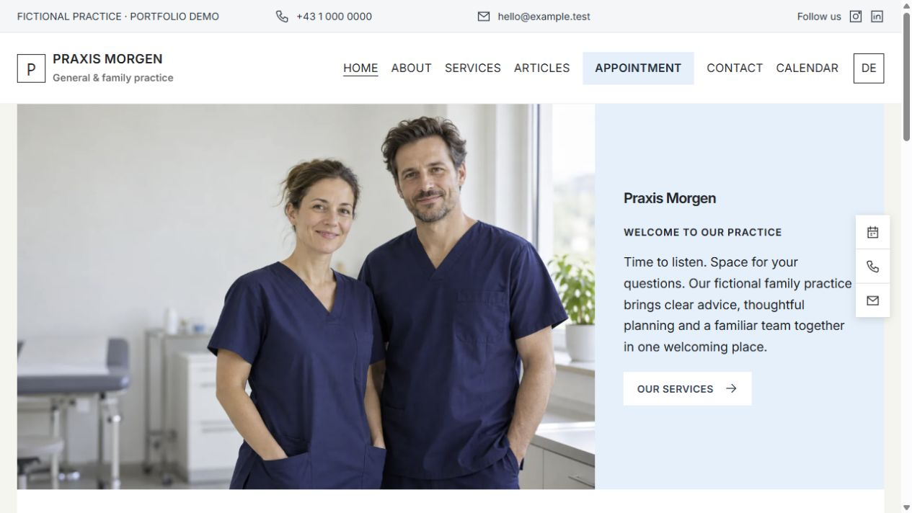

# Care CMS

A bilingual Symfony CMS with visual editing, a public content API and single-practitioner demo appointment booking. Fictional healthcare starter content, no client accounts or credentials. Intended for portfolio review and local experimentation, not patient care.

## Starter packs

Practice (Praxis Morgen) is the default, with four alternatives: Atelier, Clarity, Linden and Forma. Each starter includes Home, About, Services, Contact and Calendar pages in German and English. Each creates editable German/English drafts and integrates with the existing booking system. The Fonts screen supports self-hosted WOFF2 imports. See docs/STARTER-PACKS.md.

## Features

- German/English pages and articles, paired translations, drafts and recoverable trash.
- GrapesJS visual editor, media uploads/library, menus, announcements, revision recovery in the browser.
- Admin/editor roles, invitations, email MFA, password recovery, session limits and cache dashboard.
- Public read-only content API and a second independent frontend example.
- Booking types, availability/blocked dates, UTC-backed slots with overlap protection, confirmation emails with cancellation links, administrator monthly calendar and appointment list.

## Run locally

Requirements: PHP 8.2+ with PDO SQLite, ctype, iconv, mbstring, DOM/XML, intl, fileinfo, GD and OpenSSL; Composer; Docker only for the optional local email inbox. No Node build required.

1. `composer install`
2. `docker compose up -d` (starts local Mailpit; alternatively configure your own local SMTP catcher privately).
3. `php bin/setup.php`
4. `php bin/console app:create-admin reviewer@example.test` — choose your own password, at least 14 characters, maximum 72 bytes. No default password is shipped.
5. `php -S 127.0.0.1:8020 -t public bin/router.php`

Website: http://127.0.0.1:8020/en/
Login: http://127.0.0.1:8020/manage/login?_locale=en
Local mail inbox (MFA, reset, invitations and bookings): http://127.0.0.1:8025
Booking: http://127.0.0.1:8020/booking/
Calendar: http://127.0.0.1:8020/manage/calendar

Do not use a real patient email or medical details. Mailpit captures local emails without delivering them externally. If MFA cannot send, check that the email catcher is running. Setup preserves existing pages and never resets accounts. To run elsewhere change DEFAULT_URI in .env.local before seeding. Do not expose the PHP development server to the internet.

## Suggested reviewer walkthrough

1. Sign in with your own account and retrieve the MFA code from Mailpit.
2. Edit a page visually; switch language; publish an article; restore a trashed draft.
3. Invite an editor and inspect the role boundary (no account management or appointment data).
4. Choose a working date at /booking/, create a fictional appointment and find it on the dashboard calendar. The overlapping slots disappear. Open its cancellation email link; cancellation requires a confirmation POST.
5. Start the separate frontend on port 5173; see the same published content in a different design.

`php tests/run.php` runs service, API boundary, booking, migration and template checks. CI runs installation and Symfony checks on Linux. See docs/VERIFICATION.md for the actual local validation status.

## Frontend / AI integration

See docs/API.md for the contract, separate frontend and an AI-tool prompt. AI is not embedded in the CMS and receives no admin credentials. Any framework can consume the public read API; this version exposes sanitized HTML rather than portable component blocks.

## Honest scope

The booking/calendar is a local demo for one practitioner. No Google Calendar integration, patient portal, medical records, billing or multi-tenant hosting is included. See docs/ARCHITECTURE.md and SECURITY.md for limitations, deployment considerations and next steps.

## Download and installation

On GitHub, choose **Code → Download ZIP**, extract it, and follow Run locally above. The download contains source code, fictional starter content and bundled visual-editor assets. It does **not** contain Composer dependencies or an administrator account: run `composer install` and setup first. Docker currently starts the local email inbox only; it does not run the PHP application. A one-click hosted installer is not included.

## License

MIT for application code, with original notices retained. Dependencies/fonts retain their respective licenses; see THIRD_PARTY_NOTICES.md. No client assets or private repository history are included. This folder is a standalone project, not an update to a client website.

## Publication status

Source repository: https://github.com/timgumj/care-cms . A versioned downloadable release and hosted demonstration are not published yet. This is a portfolio prototype; see SECURITY.md before any real deployment.

## Mint Practice theme update

The default Practice design uses self-hosted Hanken Grotesk, mint/teal layouts, a bilingual eight-post journal, related articles, published-content search, and editable demonstration policy pages. Existing starter designs remain available.

For an existing installation, run `php bin/setup.php` once. The update adds missing fictional content and installs the mint design as a separate starter site; previous pages, users and bookings are retained. It does not replace edited articles or policies. If a different starter is active, it remains selected.

Administrators can choose **Appearance → Desktop navigation** for visible links or a menu button. Mobile always uses a menu button. Policy pages are examples to replace for your own organisation; they are not legal advice.

Local login: `http://127.0.0.1:8020/manage/login?_locale=en`. Use the administrator you created. Local verification emails are available in Mailpit at `http://127.0.0.1:8025` after `docker compose up -d`. No default credentials are included.
